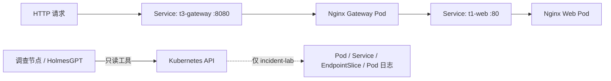

# AI SRE 架构与故障调查流程

本 AI SRE 项目基于三节点 Kubernetes 集群，在独立命名空间 `incident-lab` 部署两个 Nginx 服务。HolmesGPT 在开发机上通过只读工具收集证据并调查故障，恢复操作由工程师执行。

## 核心组件

| 组件 | 作用 |
|---|---|
| `t1-web` | Nginx 下游服务，Service 端口 80 |
| `t3-gateway` | Nginx 网关，Service 端口 8080；`/healthz` 独立返回 200，`/api/` 代理到 `t1-web:80` |
| `t3-gateway-config` | 保存网关代理配置，通过 ConfigMap 和 `subPath` 挂载 |
| HolmesGPT 0.43.0 | 借助模型选择调查工具、分析返回的证据 |
| `incident-lab/readonly` | 固定命名空间的三个调查工具，无用户自定义 shell 参数 |

## 只读工具与调查路径

1. `incident_lab_pod_snapshot`：了解 Pod 是否存在和运行状态。
2. `incident_lab_service_route_evidence`：读取 Pod、Service、EndpointSlice，比较标签、选择器和后端端口。
3. `incident_lab_gateway_error_logs`：读取网关最近 15 分钟的日志，最多 80 行。

Agent 通过现有 ServiceAccount 的命名空间级权限访问 API；故障注入和恢复由人工使用独立管理身份操作。工具源文件位于 [toolsets](../toolsets/incident-lab-readonly.yaml)。

## 已验证的故障

- **T1**：Service Selector 与 Pod 标签不匹配，EndpointSlice 无可用后端；Agent 根据资源证据定位。
- **T3**：代理端口从 80 错误设为 81，网关健康检查 200、业务 502；增加日志工具后，Agent 对比日志中的 81 和 Service 的 80，定位错误端口。

参见 [T1](t1-investigation.md) 与 [T3 对照实验](t3-investigation.md)。

## 已知边界

- GitHub 中的 [Kubernetes 清单](../k8s/incident-lab.yaml) 依据运行环境参数重建，仅通过客户端解析，尚未在全新集群部署验收。
- 仓库没有提供完整的 Agent 权限配置、模型凭据或一键部署脚本，因此尚不能称为端到端一键复现。
- 没有证明 Agent 能自动修复故障，也没有进行长期稳定性或统计显著性验证。
